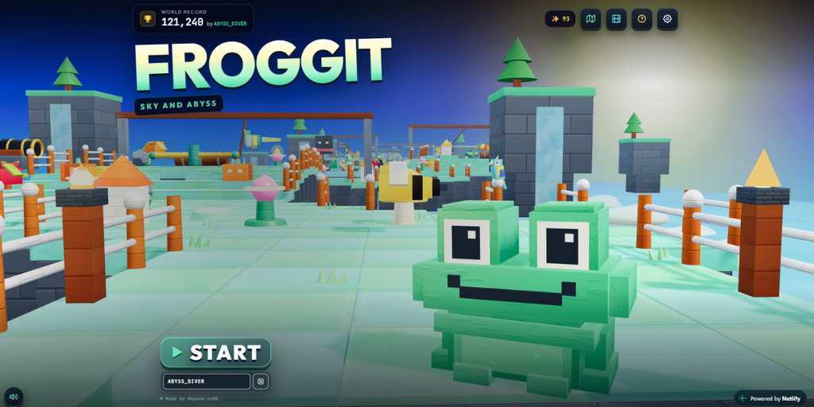

# 🐸 Froggit — Sky and Abyss ([Play Live](https://thefroggit.netlify.app))

  

> **🎮 Playable Link:** [https://thefroggit.netlify.app/](https://thefroggit.netlify.app/)


Hey! This is **Froggit — Sky and Abyss**, a fun 3D obstacle-course game I built for the browser. You play as **Tode**, a little voxel frog hopping across floating islands, hills, and moving ferries—trying to either climb all the way up into the clouds or dive down into the deep ocean trenches.

## 🌍 Welcome to the World & How Things Work

On your first play (or anytime you click the **🎬 Cutscene** button on the title screen), a dramatic **automated 4-chapter 3D story animation** plays automatically—switching camera angles, POVs (including 1st-person Toad eye-view and 360° orbits), frog skins, enemy sprites, and realms (`0F` Ground Meadow, `+2F` Star Temple, and `-2F` Kelp Trench) with live narrator subtitles at the bottom of the screen:

1. **Meet Tode & The Floating Course**: You start on a quiet stone terrace at the edge of the **🌿 Ground Meadow**. Ahead of you is a winding 96-row path made of grass tiles, steep highland ramps, split-island forks, and moving ferry platforms suspended over open water.
2. **Your Pink Tongue & Lily-Posts (`👅` & `🪷`)**: Unlike classic lane-crossing games where you can only run away, Tode can fight back! Touching patrolling bugs directly will wipe you out, so use your **pink tongue** (`Spacebar` or `Left-Click`) to snipe them out of mid-air for points and combos. You can also latch onto **🪷 Grapple Lily-Posts** to zip right across chasms, or reel in hovering **✨ Golden Fireflies** to unlock new frog skins.
3. **Traps That Shove & Checkpoints (`🚩`)**: Along the trail, you'll run into **Bastion Cannons**, **Swinging Battle-Axes**, **Vertical Thwomp Monoliths**, **Rolling Logs**, and **Spinning Sweepers**. These physical traps won't instantly kill you—they **shove Tode** a tile away! Just watch your footing near unfenced cliff edges. Cross any glowing **🚩 Checkpoint** pad (Rows `28`, `56`, and `78`) to save your spot so you can press `Enter ↵` to revive right there if you fall.
4. **The Goal — Sky or Abyss (`☀️` vs `🌊`)**: At the end of each realm (Row `90`), you'll face the **Realm Guardian**, which takes **3 tongue strikes** to break its crystal shields. Past the guardian stand the **Portal Hoops**:
   - Jump into the **☀️ Sky Ascent Hoop** to climb through **☁️ Sky Gardens (`+1`)**, **✨ Star Temple (`+2`)**, and reach the **👑 Sun Crown (`+3`)**.
   - Jump into the **🌊 Ocean Dive Hoop** to plunge through **🐠 Coral Reef (`-1`)**, **🪼 Kelp Trench (`-2`)**, and reach the **🌊 Mariana Abyss (`-3`)**.
   - Conquer either the `+3` Sun Crown or `-3` Mariana Abyss to trigger the **Victory Sanctuary Celebration**!

## 🎮 Controls

| Action | Desktop (Keyboard & Mouse) | Mobile / Touch | Controller (Gamepad) |
| :--- | :--- | :--- | :--- |
| **Hop Forward / Back / Left / Right** | `W A S D` or `Arrow Keys` | Bottom-Left **D-Pad** or **Swipe** | **D-Pad** or **Left Stick** |
| **Whip Pink Tongue** | `Spacebar` or **Left-Click** | Bottom-Right **`👅 WHIP`** or **Tap** | **`A` / `Cross`** or **`RT`** |
| **Revive at Checkpoint** | `Enter ↵` | Tap **`🚩 REVIVE`** Banner | **`A` / `Cross`** on Wipeout |
| **Toggle Music On / Off** | `M` Key or **Bottom-Left `🔊` Button** | **Bottom-Left Circular `🔊` Button** | In-Game Settings |
| **Skip Automated 3D Story Cutscene** | `Esc` (Auto-advances hands-free) | Tap **`Skip Cutscene [ESC]`** | **`Start` / `B`** |
| **Pause & Settings** | `Esc` | Top-Right **⚙️ Button** | **`Start` / `Options`** |
| **How to Play Guide** | `H` or `?` | Top-Right **`?` Button** | UI Navigation |

## 🎵 Adding Your Own Background Music (BGM)

The game is wired to play a **calm theme song** during normal exploration (and on the title/story intro), **stop** the music when Tode dies, **restart** the calm theme from the beginning when you revive or retry, and switch to a **celebration song** when you win!

Place your two non-copyrighted audio files in `assets/audio/`:

```text
assets/
└── audio/
    ├── calm-theme.mp3       # Plays normally; stops on death; restarts from 0:00 on revive/retry
    └── celebration.mp3      # Plays when you win a realm hoop or conquer the campaign finale
```

*(If those `.mp3` files aren't in the folder yet, the game automatically falls back to a built-in Web Audio melody synthesizer so you still get calm music and victory celebration tunes out of the box—and you can toggle music anytime with the circular button in the bottom-left corner!)*

You can also register custom audio files at runtime from the browser console or your own script:

```javascript
window.registerFroggitAudio('bgm_calm_theme', './assets/audio/calm-theme.mp3');
window.registerFroggitAudio('bgm_celebration', './assets/audio/celebration.mp3');
```

## 🚀 Running the Game Locally

### Option 1: Standalone Single-File (`dist/froggit.html`)
Just double-click `dist/froggit.html` to play in any browser—no server or setup needed.

### Option 2: Local Dev Server (Vite or Python)
```bash
# With Vite
npm install
npm run dev

# Or with Python (no install required)
python3 -m http.server 8080
```

## 🗂️ Project Structure & Tech Stack

```text
Froggit/
├── README.md                          # Game intro, controls & setup guide
├── package.json                       # Vite dev server scripts
├── vite.config.js                     # Vite configuration
├── index.html                         # Main HTML shell, HUD, 3D intro overlay & modals
├── assets/
│   └── audio/                         # Drop calm-theme.mp3 and celebration.mp3 here
├── dist/
│   └── froggit.html                   # Single-file standalone build
└── src/
    ├── main.js                        # 60 FPS game loop, 3D story intro camera & bootstrap
    ├── styles/
    │   ├── tokens.css                 # CSS variables & colors
    │   ├── components.css             # UI panels, HUD buttons & corner music toggle
    │   └── animations.css             # Keyframes, floating callouts & iris transitions
    ├── audio/
    │   └── ProceduralAudio.js         # BGM lifecycle manager (calm/stop/restart/celebrate) + Web Audio synth
    ├── state/
    │   └── gameState.js               # 7 realms, 5 frog skins, story intro chapters & localStorage
    ├── rendering/
    │   └── sceneAndShaders.js         # Three.js scene, lighting & procedural canvas textures
    ├── entities/
    │   ├── todeRig.js                 # 3D Tode rig, facial expressions, tongue & target reticle
    │   └── enemiesAndParticles.js     # Biome creatures, Realm Guardian boss & particle bursts
    ├── world/
    │   └── courseBuilder.js           # 96-row winding course, traps, ferries & finish shrine
    ├── ui/
    │   └── minimapAndWorldMap.js      # Top-down minimap & 7-realm world map modal
    ├── gameplay/
    │   └── mechanicsAndModals.js      # Hopping, story intro flow, tongue grapple, knockback & modals
    └── input/
        └── controls.js                # Keyboard, mouse, touch D-pad & corner music button bindings
```

- **Built with**: Three.js (`r128`), Tailwind CSS (`3.4`), HTML5 Canvas, and the Web Audio API.
- **Attribution & License**: Released under the [MIT License](./LICENSE). Built as a personal creative entry for the [JetBrains Academy Build Your Game Challenge](https://academy.jetbrains.com/course/30327) with assistance from JetBrains Junie and Gemini.
